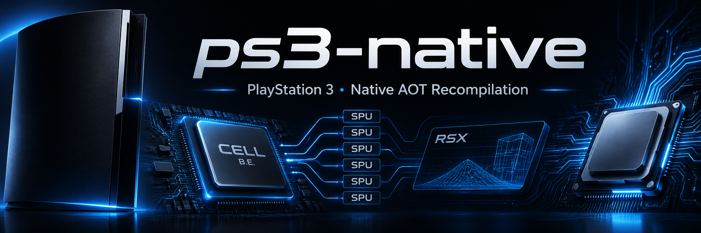

<div align="center">



# ps3-native

**An open research project for native ahead-of-time recompilation of PlayStation 3 software, targeting original games and the authentic VSH/XMB.**

[](https://github.com/fabegalo/ps3-native/actions/workflows/ci.yml)
[](#current-status)
[](#current-status)
[](LICENSE)

[English](README.md) · [Português (Brasil)](README.pt-BR.md) · [Build](#build-and-check) · [Commands](#command-contracts)

</div>

> **Experimental research, not a playable PS3 launcher.** The banner is concept art. Synthetic PPU/SPU and RSX tests pass. The launcher can now enter original retail PPU startup code in a bounded AOT diagnostic session. No game menu, gameplay or original VSH/XMB boot is verified.

Built on [ps3recomp](https://github.com/sp00nznet/ps3recomp) by **Ned Heller / sp00nznet**, following the shared architecture of [x360-native](https://github.com/fabegalo/x360-native), [ps2-native](https://github.com/fabegalo/ps2-native) and [xone-native](https://github.com/fabegalo/xone-native). The goal is an authentic **system → game → system** lifecycle; the management launcher does not imitate the XMB.

<a id="current-status"></a>

## Current status

| Area | Demonstrated | Not yet demonstrated |
| --- | --- | --- |
| PPU / SPU AOT | Project-owned synthetic programs compiled and executed; SPU DMA verified | Generic commercial game execution |
| RSX graphics | Upstream D3D12 pixel/depth regression validated on a local GPU | Playable titles or broad RSX coverage |
| Import / preparation | Read-only inventory, PPU AOT, hash-bound diagnostic native startup | Complete generic module loading and playable title launch |
| Original firmware | PUP identity inspection; upstream firmware LLE research | Original VSH/XMB boot, Guide-like system navigation, or game return |
| Platforms | Windows x64 locally validated; Windows, Linux and macOS CI configured | Runtime certification across all planned targets |

## Build and check

Requirements: Git, CMake 3.25+, Ninja, Python 3.11+ and Clang with a C/C++20
toolchain. On Windows use **clang-cl**, MSVC headers/libraries and Windows SDK;
`cl.exe` alone cannot compile the upstream builtins. Reuse an installed toolchain.
On Linux install SDL2 development files; on macOS install SDL2 (e.g. Homebrew).
The checked-in CI builds Windows, Linux and macOS; ARM targets remain planned.

```sh
git clone --recurse-submodules https://github.com/fabegalo/ps3-native.git
cd ps3-native
# Existing checkouts: git submodule update --init
cmake -S . -B build -G Ninja -DCMAKE_BUILD_TYPE=Release \
  -DCMAKE_C_COMPILER=clang -DCMAKE_CXX_COMPILER=clang++
cmake --build build --parallel 3
ctest --test-dir build --output-on-failure
```

Windows, from an x64 developer prompt with clang-cl, CMake and Ninja on PATH:

```powershell
cmake -S . -B build -G Ninja -DCMAKE_BUILD_TYPE=Release -DCMAKE_C_COMPILER=clang-cl -DCMAKE_CXX_COMPILER=clang-cl
cmake --build build --parallel 3
ctest --test-dir build --output-on-failure
.\build\ps3-native.exe --help
```

`scripts/devshell.cmd` can initialize an existing Visual Studio x64 environment;
it does not install tools or change the machine environment. This source-tree
launcher delegates to the configured Python interpreter and CLI. It is not yet
a relocatable end-user distribution. No ZIP or Release is produced in M0.

## Command contracts

On POSIX the launcher is `build/ps3-native`; Python can also invoke the same CLI:

```sh
python src/ps3native/cli.py inspect "/path/to/game/PS3_GAME"
python src/ps3native/cli.py --catalog .local/catalog import "/path/to/PS3UPDAT.PUP"
python src/ps3native/cli.py prepare "/path/to/readable/EBOOT.elf"
python src/ps3native/cli.py prepare --fixture ppu
python src/ps3native/cli.py run --fixture ppu
python src/ps3native/cli.py prepare --fixture spu
python src/ps3native/cli.py run --fixture spu
python src/ps3native/cli.py system
```

Suggested local layout: `content/games/<title>/PS3_GAME/` and
`firmware/PS3UPDAT.PUP`, both ignored by Git. Originals may also stay on another
drive; pass their existing paths to `import` without moving or duplicating them.

| Command | Actual M0 behavior |
| --- | --- |
| `inspect PATH` | Read-only recursive inventory, file sizes/SHA-256, PARAM.SFO metadata, PUP table/version text and ELF/SELF/PKG identification. JSON output. |
| `import PATH` | Same inventory, atomically saves a manifest outside originals; references original paths, never copies game trees. Identical imports reuse the content ID. |
| `prepare PATH [--cache PATH]` | Single readable big-endian PPU ELF64 ET_EXEC: upstream parsing, OPD/TOC/import analysis and actual PPU AOT C generation. Receipts hash input, adapter, upstream and outputs. Returns **3** because general native build/dependency certification remains blocked. |
| `prepare --fixture ppu\|spu [--build-dir PATH]` | CMake generates, compiles and links the explicitly synthetic fixture with the existing upstream runtime. Incremental compiler/header/tool dependencies are tracked by CMake/Ninja. |
| `run --fixture ppu\|spu` | Checks locked upstream and fixture hashes, executes the compiled synthetic fixture and returns its real result. |
| `run PATH` | Starts a hash-bound native diagnostic module for that exact input revision, or returns **3** when none is prepared. Missing runtime support stops with **86**. |
| `system` | Returns **3**: original VSH/XMB boot and system/game lifecycle are not implemented. |

### Native startup diagnostics

Supply a readable ELF derived locally from your own original. RPCS3's official
portable `--decrypt` tool can provide it; RPCS3 is not the execution backend.
Never put the ELF, keys or generated code in Git. Generate AOT first with
`prepare EBOOT.elf`; its JSON returns the cache directory even when returning
3 to indicate the native build is still pending. Then:

```sh
python src/ps3native/cli.py prepare /original/PS3_GAME --build-native --elf /local/EBOOT.elf --aot-dir /local/aot-cache
python src/ps3native/cli.py run /original/PS3_GAME
```

The offline startup slice includes the entry, small OPD pointer tables and
reachable direct targets. After a stopped run reports a missing PPU target,
repeat preparation to extend the slice and incrementally rebuild. There is no
compilation during guest execution, interpreter or JIT fallback. HLE calls need
an audited implementation; unsupported instructions/calls stop with 86.
Sessions verify original, ELF, generated-code, binary, runtime and configuration
hashes, separate writable HDD state, and stop after 20 seconds or when logs
cross 1 MiB. A diagnostic start is not gameplay.

Exit codes: **0** completed operation; **2** invalid/missing input, I/O or tool
failure; **3** unavailable execution/preparation stage. Fixture preparation/run
preserves compiler/process error codes. Content IDs include relative names,
sizes, kinds and file hashes; no signed firmware authenticity is claimed.
Links/junctions and malformed SFO/PUP bounds are rejected. A codegen cache hit
rechecks all recorded output hashes; changed input or adapter uses another cache.
Interrupted stages never replace valid published caches. M0 temporarily stages
one executable (maximum 256 MiB); it does not stage entire games. Treat originals
as stable during inspection; this is not a filesystem snapshot or security sandbox.

## Architecture and dependency

The seven shared boundaries follow
[x360-native](https://github.com/fabegalo/x360-native), with
[ps2-native](https://github.com/fabegalo/ps2-native) and
[xone-native](https://github.com/fabegalo/xone-native) as companion references:
management launcher; content/catalog; preparation/native execution; compatibility
runtime/HLE; Original GPU/Native GPU; original system/games; session supervisor/
host adapters. Their current ownership and approval rules are in [AGENTS.md](AGENTS.md).

The submodule base and `deps.lock.json` fix ps3recomp to
**`de4f090328ea08bef6b2f15caec0b85e343a7ece`** (upstream HEAD inspected on
2026-11-14). A hash-locked generic patch adds strict stops for missing direct/
indirect PPU targets, unhandled LV2 and SPU interpretation, gates HLE dispatch
to audited services, retains registered process-spawn callbacks, uses live
memory accounting and correct UTC wall time on Windows. No runtime
is copied. PPU register,
VMX, endian, OPD/TOC and memory behavior, and SPU local store, DMA and channels
come from upstream. These tiny fixtures do not certify complete ISA, exceptions,
SPURS, synchronization or floating-point fidelity. Upstream has interpreter and
title-specific paths: they are not approved production fallbacks in ps3-native.

| Backend | Upstream availability / current evidence |
| --- | --- |
| D3D12 | Windows; real pixel regression locally validated on NVIDIA RTX 4070. |
| Vulkan | Linux-only opt-in `-DPS3RECOMP_RSX_VULKAN=ON`; requires Vulkan headers, guest shaders need glslang. Not locally validated. |
| Metal | Apple-only; guest shader translation needs glslang + spirv-cross. Not locally validated. |

Original fidelity and Native enhancements must share RSX contracts and coherent
PPU/SPU/RSX state. M0 adds no renderer or enhanced GPU mode. Hosted CI excludes
the GPU runtime test because its runners have no certified D3D12 adapter; the
test remains mandatory on an appropriate local GPU host.

## Validation and the next real blocker

Local Windows x64 Release, Clang 22.1.8, CMake 3.31.6, Python 3.13.17:

- PPU: own PPC64 ELF → upstream OPD analysis/lifter → native compilation →
  upstream ELF loader/dispatch → big-endian result **42**. Wrong-result control fails.
- SPU: own instructions → upstream lifter → native execution → real MFC GET,
  four-word increment and PUT; all **16 bytes** checked in LS and main memory.
  Corrupt-input control fails. No interpreter is invoked by this straight-line test.
- RSX: upstream NV4097/guest vertex and fragment program draw, D3D12 hardware
  render/readback; four Z16/Z24S8 depth-clear cases, **256 pixels per case**.
  Three draws must be white; the occluded draw must remain black.
- Catalog/preparation: SFO/PUP bounds, Unicode paths, idempotency, originals,
  revisions, actual generated-code changes, cache reuse/tampering and unavailable
  commands. A symlink case is explicitly skipped if the host lacks link permission.
- Runtime: missing/unaudited HLE, LV2, PPU and SPU interpretation stop; real
  mutex contention, callback retention, allocation/free accounting and clock
  results are checked with synthetic contexts.

Own fixtures remain the public regression inputs. A user-provided retail game
was also tested locally through original CRT startup; its code and derived
outputs stay ignored. No Sony SDK was used. Windows x64 is the local
validated build; Linux/macOS evidence belongs to the CI run for the actual commit.
Windows/Linux ARM64, macOS Intel/Apple Silicon coverage and Steam Deck runtime
must be reported separately from the CI runner's particular architecture.

The local **EL CHAVO KART (BLUS31198, 01.00)** session reaches the original
PPU CRT/static constructors, original SFO metadata and a local NP pool without
sign-in. It initializes GCM, opens the real D3D12 1280×720 output, maps 10 MiB
of main memory into RSX IO, registers three display buffers and executes an RSX
FIFO label fence and a screen-clear command. Original startup creates the
`FlipPump` and `_SPU_printf_server` threads, an event queue and a connected port.
The authorized original firmware 4.93 `libsre.prx` now supplies `cellSpurs`:
440 PPU functions and 149 exports are compiled and bound separately from HLE.
Its original initializers create an exclusive group of five SPUs and a normal
one-worker group. All six native host workers enter original firmware SPU code;
the kernel reaches `0x13F4`. Group join waits for actual completion, and synthetic
mailbox/restart regressions check exit statuses 42 and 17. Terminal SPU stops
unwind the owned execution engine instead of resuming translated callers.
Streamed code is prepared offline, matched against the complete loaded payload,
and checked byte-for-byte on function entry/return. DMA writes retire stale code;
active code changes and unknown targets stop explicitly.

Real D3D12 ZPASS reports and GPU timestamps now preserve command order without
presenting early. The hardware fixture checks 4096 visible samples, zero occluded
samples, and 256 samples after a partial depth clear. Prepared flips return their
original queue indices and wait for GPU submission; the current backend explicitly
blocks more than one prepared frame in flight until display surfaces are retained
independently. An open backend window still does not verify a game frame or menu.
El Chavo now prints `FIOS 1.3.5 initialized`, checks missing installation data
without writes, and reads Brazilian Portuguese from the host UI language. Its
latest stop is `cellGameCreateGameData` (`0x42A2E133`): writable installation and
recovery need an approved persistence contract. Original game frames remain unverified.
TTY output preserves binary bytes and real write counts. Read-only game-data
checks validate paths, SFO category and output ranges; empty directories are not
installed content. Existing-data size metadata and HDD content permission stay
blocked. System-language queries use supported configured/host values; other
system preferences and unmapped languages stop explicitly.

All 47 discovered game SPU ELFs, two embedded firmware ELFs and two verified raw
firmware payloads are compiled locally: 51 registrations with input/tool/output
hashes. Explicit boundaries separate original code from constant data in four
payloads; all loaded data remains intact. This is preparation coverage, not complete
control-flow, ISA, frame or gameplay certification.

The added **God of War Collection (BCUS98229, 02.00)** has a read-only catalog and
four locally decrypted, structurally validated PPU ELFs. Its initial EBOOT has
9,951 PPU functions compiled locally and 12 SPU programs registered, including
the original SPURS firmware. Native startup reaches SPURS handler creation and
stops at `sys_net_initialize_network_ex` (`0x139A9E9B`): the existing zero-return
placeholder cannot initialize networking. No game frame, selector transition or
gameplay is verified. Original and derived proprietary files remain outside Git.
Kernel mutex creation/destruction, uncontended locks, recursion and try-lock
errors have synthetic regressions; contended blocking explicitly stops until
guest FIFO/priority waiter ordering is implemented.
Module availability and per-API execution approval are separate. Attribute and
video layouts, live mapper quota/backing, real waits/callbacks and disc boot
metadata have focused synthetic regressions; compressed tiles remain blocked.
PPU worker creation/exit/join, priority lookup and SPU resource limits also have
regressions. Windows waits enforce their monotonic deadline after the host timer
wakes. Resource initialization does not enable unprepared SPU execution.
Once-initializer publication, event creation/connection, SPURS attribute flags
and printf callback registration have focused regressions. Prepared flips stay
in the FIFO until consumed; request-time callbacks and frame-skipping catch-up
are disabled in strict execution. Fatal diagnostics exit without guest teardown.

**Next task:** finish original CRT/static initialization through strict stops,
expand prepared indirect targets and audit reached services with real regressions.
Continue original game initialization and validate a real game frame before
claiming menu or gameplay support.
The HLE allowlist and runtime guards stop where coverage ends; production
completeness and broad ABI coverage remain unproven. Existing title-specific
upstream hooks are not generic compatibility.

Dynamic SPU images/overlays need content fingerprints, LS load address/span,
runtime/lifter revision and relocation identity, AOT preparation outside active
execution, and invalidation on DMA/code writes. Unknown images must block with
an actionable diagnostic. No JIT/interpreter fallback is authorized by M0.

## Original firmware / XMB preparation

PUP import records identity, bounded entry tables and a readable version entry
(0x100). It does **not** verify Sony signatures/HMAC, decrypt, extract dev_flash,
load a PRX, or execute VSH. Encrypted SELF, readable ELF, AOT-generated output,
compiled module and executable session are distinct states.

The upstream [FIRMWARE_LLE.md](external/ps3recomp/docs/FIRMWARE_LLE.md) documents
`tools/lift_prx.py`: user-supplied **already decrypted** PRX → relocated image,
functions, imports and exports → `ppu_lifter.py --raw --base` → compiled module.
Its SPURS example is not proof of XMB boot. Keep such outputs in ignored local
storage, separate from HLE, preserving original module hashes, firmware revision,
base/relocations and explicit NID ownership. Never distribute derived output.

`src/ps3native/firmware.py` validates an already decrypted PRX, uses the pinned
upstream relocation/lifter tools and emits a hash-bound AOT receipt. Pass that
receipt directory as `PS3_NATIVE_FIRMWARE_DIR` in the existing CMake configuration.
Only the explicitly selected library owns its exports; missing original exports
cannot silently fall back to HLE. Modules requiring a module-start contract are
rejected. Preparation and runtime reject image overlaps and reserved scratch/TLS
areas. Own synthetic PRX tests verify stack/TOC/TLS preservation, cached-artifact
tampering, export mutation and missing-export rejection. Local original extraction
and decryption use RPCS3 only as an offline tool; guest execution uses ps3recomp.
Bulk memory/string writes invalidate existing PPU/SPU reservations. Direct SPU
imports validate the ELF and publish real COPY/FILL/INFO records; protected imports
remain gated. Event receives wait for real events and return registers r4–r7.

VSH/XMB additionally needs authenticated firmware extraction, its complete module
graph and loader contracts, dev_flash resources/fonts/icons, LV2 services,
users/storage/saves, controls, library discovery, and supervised game launch/return.
These dependencies and the generic execution gate block original XMB today.
ISO/disc and PKG extraction, DLC/install management and GUI packaging are future
work; identifying a container is not supporting its execution.

## Licensing

Own code: [BSD-3-Clause](LICENSE). ps3recomp: MIT with additional bundled licenses,
including its default LGPL-2.1 ATRAC decoder. See [third-party notices](THIRD_PARTY_NOTICES.md).
[RPCS3](https://github.com/RPCS3/rpcs3) is a behavioral/technical reference;
its implementation is not copied. Supply your own lawful originals; no games,
firmware, keys, proprietary SDK or proprietary generated code are distributed.
