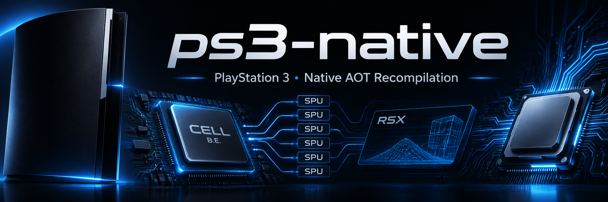

<div align="center">



# ps3-native

**Projeto aberto de pesquisa para recompilação estática AOT de software do PlayStation 3, visando jogos originais e a VSH/XMB autêntica.**

[](https://github.com/fabegalo/ps3-native/actions/workflows/ci.yml)
[](#estado-atual)
[](#estado-atual)
[](LICENSE)

[English](README.md) · [Português (Brasil)](README.pt-BR.md) · [Compilação](#compilar-e-verificar) · [Comandos](#contratos-dos-comandos)

</div>

> **Pesquisa experimental, ainda sem jogos funcionais.** O banner é uma arte conceitual. Os testes sintéticos PPU/SPU e RSX passam. O launcher agora entra no código PPU original de inicialização de um jogo retail em uma sessão AOT diagnóstica e limitada. Menu, gameplay e boot da VSH/XMB original não foram verificados.

Baseado no [ps3recomp](https://github.com/sp00nznet/ps3recomp), de **Ned Heller / sp00nznet**, e na arquitetura compartilhada de [x360-native](https://github.com/fabegalo/x360-native), [ps2-native](https://github.com/fabegalo/ps2-native) e [xone-native](https://github.com/fabegalo/xone-native). A meta é preservar o ciclo autêntico **sistema → jogo → sistema**; o gerenciador não imita a XMB.

<a id="estado-atual"></a>

## Estado atual

| Área | Já demonstrado | Ainda não demonstrado |
| --- | --- | --- |
| PPU / SPU AOT | Programas sintéticos próprios compilados e executados; DMA SPU conferida | Execução genérica de jogos comerciais |
| Gráficos RSX | Regressão upstream D3D12 de pixels/profundidade validada em GPU local | Títulos jogáveis ou ampla cobertura RSX |
| Importação / preparação | Inventário somente leitura de jogos e PUP; geração AOT limitada de ELF PPU | Binding completo de módulos e execução nativa genérica |
| Firmware original | Inspeção de identidade PUP e pesquisa LLE do upstream | Boot VSH/XMB original, navegação e retorno dos jogos |
| Plataformas | Windows x64 validado localmente; CI Windows, Linux e macOS configurada | Certificação de execução nos demais alvos |

## Compilar e verificar

Requisitos: Git, CMake 3.25+, Ninja, Python 3.11+ e Clang com suporte a C/C++20.
No Windows, use **clang-cl**, headers/bibliotecas MSVC e Windows SDK;
`cl.exe` não suporta os builtins usados pelo upstream. Reutilize ferramentas
instaladas. Linux e macOS precisam dos arquivos de desenvolvimento do SDL2.
A CI inicial inclui Windows, Linux e macOS; os alvos ARM continuam planejados.

```sh
git clone --recurse-submodules https://github.com/fabegalo/ps3-native.git
cd ps3-native
# Checkout existente: git submodule update --init
cmake -S . -B build -G Ninja -DCMAKE_BUILD_TYPE=Release \
  -DCMAKE_C_COMPILER=clang -DCMAKE_CXX_COMPILER=clang++
cmake --build build --parallel 3
ctest --test-dir build --output-on-failure
```

No Windows, em um prompt de desenvolvimento x64 com clang-cl, CMake e Ninja no PATH:

```powershell
cmake -S . -B build -G Ninja -DCMAKE_BUILD_TYPE=Release -DCMAKE_C_COMPILER=clang-cl -DCMAKE_CXX_COMPILER=clang-cl
cmake --build build --parallel 3
ctest --test-dir build --output-on-failure
.\build\ps3-native.exe --help
```

`scripts/devshell.cmd` inicializa o ambiente Visual Studio x64 já instalado;
não instala ferramentas nem altera o ambiente global. O launcher deste checkout
usa o Python e o código-fonte configurados pelo CMake. Ainda não é uma distribuição
portável para o usuário final. O M0 não cria ZIP ou Release.

## Contratos dos comandos

No POSIX, o launcher é `build/ps3-native`. O mesmo CLI também aceita:

```sh
python src/ps3native/cli.py inspect "/caminho/jogo/PS3_GAME"
python src/ps3native/cli.py --catalog .local/catalog import "/caminho/PS3UPDAT.PUP"
python src/ps3native/cli.py prepare "/caminho/legivel/EBOOT.elf"
python src/ps3native/cli.py prepare --fixture ppu
python src/ps3native/cli.py run --fixture ppu
python src/ps3native/cli.py prepare --fixture spu
python src/ps3native/cli.py run --fixture spu
python src/ps3native/cli.py system
```

Organização local sugerida: `content/games/<jogo>/PS3_GAME/` e
`firmware/PS3UPDAT.PUP`, ambos ignorados pelo Git. Os originais também podem
continuar em outro disco; importe o caminho existente sem movê-los ou duplicá-los.

| Comando | Comportamento efetivo no M0 |
| --- | --- |
| `inspect CAMINHO` | Inventário recursivo somente leitura: tamanhos, SHA-256, PARAM.SFO, tabela/versão textual do PUP e identificação ELF/SELF/PKG. Saída JSON. |
| `import CAMINHO` | Mesmo inventário, com manifesto publicado atomicamente fora dos originais. Referencia caminhos, sem copiar árvores de jogos; importações iguais reutilizam o ID. |
| `prepare CAMINHO [--cache CAMINHO]` | Um ELF64 PPU ET_EXEC big-endian legível: parsing, OPD/TOC/imports e geração AOT C pelo upstream. Recibos verificam hashes da entrada, adaptador, upstream e saídas. Retorna **3**, pois a compilação e certificação genérica de dependências continuam bloqueadas. |
| `prepare --fixture ppu\|spu [--build-dir CAMINHO]` | Gera, compila e vincula a fixture explicitamente sintética ao runtime existente. CMake/Ninja controlam invalidação incremental por compilador, headers, ferramentas e entradas. |
| `run --fixture ppu\|spu` | Confere upstream e hashes da fixture, executa o binário sintético e devolve seu resultado real. |
| `run CAMINHO` | Inicia o módulo nativo diagnóstico vinculado por hashes àquela revisão, ou retorna **3** se não houver módulo preparado. Suporte ausente interrompe com **86**. |
| `system` | Retorna **3**: boot VSH/XMB original e ciclo sistema/jogo ainda não implementados. |

### Diagnóstico de inicialização nativa

Forneça um ELF legível obtido localmente do seu original. A ferramenta portátil
oficial `RPCS3 --decrypt` pode obtê-lo; RPCS3 não é o backend de execução.
Não coloque ELF, chaves ou código gerado no Git. Gere AOT com `prepare EBOOT.elf`;
o JSON informa o cache mesmo retornando 3, pois a compilação ainda está pendente.
Depois:

```sh
python src/ps3native/cli.py prepare /original/PS3_GAME --build-native --elf /local/EBOOT.elf --aot-dir /local/cache-aot
python src/ps3native/cli.py run /original/PS3_GAME
```

A fatia offline inclui a entrada, pequenas tabelas OPD e destinos diretos.
Quando uma execução parar por destino PPU ausente, repita a preparação para
ampliá-la e recompilar incrementalmente. Não há compilação durante execução
guest, intérprete ou fallback JIT. HLE exige implementação auditada;
instruções/chamadas sem suporte interrompem com 86. A sessão confere hashes dos
originais, ELF, código gerado, binário, runtime e configuração, separa o HDD
gravável e para após 20 segundos ou quando os logs ultrapassam 1 MiB.
Início diagnóstico não comprova gameplay.

Códigos: **0** operação concluída; **2** entrada inválida/ausente, erro de I/O
ou ferramenta; **3** etapa de preparação/execução indisponível. Preparação e
execução das fixtures preservam os códigos reais do compilador/processo.
O ID considera nomes relativos, tamanhos, tipos e hashes; não autentica firmware.
Links/junctions e limites SFO/PUP inválidos são rejeitados. Reutilizar cache
exige conferir todos os hashes de saída; mudanças de entrada/adaptador geram
outro cache. Uma etapa interrompida não substitui caches válidos. A geração
copia temporariamente apenas um executável, limitado a 256 MiB, sem duplicar
jogos. Mantenha os originais estáveis durante a inspeção; não há snapshot
transacional do sistema de arquivos ou sandbox de segurança.

## Arquitetura e dependência

As sete fronteiras seguem o
[x360-native](https://github.com/fabegalo/x360-native), com
[ps2-native](https://github.com/fabegalo/ps2-native) e
[xone-native](https://github.com/fabegalo/xone-native) como referências:
launcher; conteúdo/catálogo; preparação/execução nativa; runtime/HLE;
Original GPU/Native GPU; sistema/jogos originais; supervisor/adaptadores.
Responsabilidades atuais e validação de novas decisões estão em [AGENTS.md](AGENTS.md).

O submódulo preservado e `deps.lock.json` fixam o ps3recomp em
**`de4f090328ea08bef6b2f15caec0b85e343a7ece`**, HEAD consultado em 14/11/2026.
Um patch genérico com hashes fixos bloqueia destinos PPU diretos/indiretos
ausentes, LV2 sem implementação e interpretação SPU; restringe HLE a serviços
auditados e preserva callbacks registrados de saída/spawn; usa contabilidade
real de memória e horário UTC correto no Windows. Não há runtime
duplicado. Registradores, VMX, endianness,
OPD/TOC e memória PPU, local store, DMA e canais SPU vêm do upstream. As fixtures
não certificam toda a ISA, exceções, SPURS, sincronização ou ponto flutuante.
O upstream contém intérprete e caminhos específicos por título; sua existência
não os autoriza como fallback de produção do ps3-native.

| Backend | Disponibilidade upstream / evidência |
| --- | --- |
| D3D12 | Windows; regressão de pixels validada localmente na NVIDIA RTX 4070. |
| Vulkan | Opcional somente no Linux: `-DPS3RECOMP_RSX_VULKAN=ON`; precisa de headers Vulkan; shaders guest precisam de glslang. Sem validação local. |
| Metal | Somente Apple; tradução de shaders guest precisa de glslang + spirv-cross. Sem validação local. |

Fidelidade Original e melhorias Native devem compartilhar contratos RSX e estado
coerente entre PPU/SPU/RSX. O M0 não cria renderer nem implementa melhorias Native.
A CI hospedada exclui execução do teste D3D12 porque não possui adaptador certificado;
o teste permanece obrigatório em uma máquina local com GPU apropriada.

## Validação e próximo bloqueio real

Windows x64 Release local, Clang 22.1.8, CMake 3.31.6 e Python 3.14.8:

- PPU: ELF PPC64 próprio → análise OPD/lifter upstream → compilação nativa →
  loader/dispatch upstream → resultado big-endian **42**. Controle com resultado
  esperado incorreto falha.
- SPU: instruções próprias → lifter upstream → execução nativa → MFC GET,
  incremento de quatro palavras e PUT; **16 bytes** conferidos em LS e memória
  principal. Controle com entrada corrompida falha. O teste linear não usa intérprete.
- RSX: comandos NV4097 e programas vertex/fragment do teste upstream → D3D12
  na GPU física → leitura de pixels. Quatro casos de profundidade Z16/Z24S8,
  **256 pixels por caso**: três desenhos brancos e um desenho ocluído preto.
- Catálogo/preparação: limites SFO/PUP, Unicode, idempotência, originais,
  revisões, alteração real do código gerado, cache e adulteração, comandos indisponíveis.
  O caso de symlink é pulado explicitamente quando o host não permite criar links.
- Runtime: chamadas ausentes/não auditadas e interpretação SPU interrompem;
  exclusão mútua real, callbacks, alocação/liberação e relógios são conferidos
  com contextos sintéticos.

As regressões públicas usam fixtures próprias. Um jogo retail fornecido pelo
usuário também foi testado localmente até o código original de inicialização
do CRT; código e resultados derivados permanecem ignorados pelo Git.
Nenhum SDK Sony foi usado. A compilação validada
localmente é Windows x64; Linux/macOS dependem da execução CI do commit exato.
Windows/Linux ARM64, variantes Intel/Apple Silicon e Steam Deck exigem evidência
própria; uma matriz de runners não comprova todas as arquiteturas ou execução.

A sessão local de **EL CHAVO KART (BLUS31198, 01.00)** chega ao CRT/construtores
PPU originais e à ativação do filesystem HLE, depois para explicitamente em
`CELL_SYSMODULE_SPURS` (0x000A). Nenhum frame, menu ou gameplay foi verificado.
A descoberta offline encontrou 47 imagens SPU embutidas: 45 geradas sem
instruções pendentes reportadas; duas rejeitadas porque faixas executáveis incluem
dados decodificados como instruções. O registro incompleto permanece desativado.
Semântica dos parâmetros SPURS, cobertura de imagens e ABI ainda precisam de
implementação e validação.

**Próxima tarefa:** concluir CRT/construtores originais através das paradas
diagnósticas, ampliar destinos indiretos preparados e auditar serviços alcançados
com regressões reais. Concluir binding PRX e registro AOT SPU antes de habilitar
seus chamadores. A lista HLE auditada e as barreiras param onde o suporte termina;
completude de produção e ABI ampla continuam sem comprovação. Hooks upstream
por título não provam compatibilidade genérica.

Imagens/overlays SPU dinâmicos precisam de fingerprint, endereço/faixa LS,
revisão de runtime/lifter e identidade de relocação, preparação AOT fora da
execução ativa e invalidação por DMA/escrita de código. Imagens desconhecidas
devem bloquear com diagnóstico útil. M0 não autoriza fallback JIT/intérprete.

## Preparação do firmware original / XMB

A importação PUP registra identidade, entradas com limites conferidos e versão
legível (entrada 0x100). Não verifica assinatura/HMAC Sony, descriptografa,
extrai dev_flash, carrega PRX ou executa VSH. SELF criptografado, ELF legível,
saída AOT, módulo compilado e sessão executável são estados diferentes.

[FIRMWARE_LLE.md](external/ps3recomp/docs/FIRMWARE_LLE.md) documenta
`tools/lift_prx.py`: PRX fornecido pelo usuário **já descriptografado** → imagem
relocada, funções, imports/exports → `ppu_lifter.py --raw --base` → módulo
compilado. O exemplo SPURS não comprova boot da XMB. Essas saídas devem ficar
locais, ignoradas pelo Git e separadas do HLE, com hashes originais, revisão do
firmware, base/relocações e propriedade explícita de NIDs. Não redistribuí-las.

A VSH/XMB também exige extração autenticada do firmware, grafo completo de
módulos e contratos do loader, dev_flash/fontes/ícones, serviços LV2,
usuários/armazenamento/saves, controles, biblioteca e inicialização/retorno
supervisionado de jogos. Essas dependências e a barreira de execução genérica
impedem a XMB hoje. Extração ISO/PKG, DLC/dados instalados e distribuição com
GUI ficam para etapas seguintes; identificar contêiner não significa executá-lo.

## Licenças

Código próprio: [BSD-3-Clause](LICENSE). ps3recomp: MIT, com licenças adicionais,
incluindo o decoder ATRAC LGPL-2.1 habilitado por padrão.
Veja [os créditos de terceiros](THIRD_PARTY_NOTICES.md).
[RPCS3](https://github.com/RPCS3/rpcs3) é referência técnica/comportamental;
sua implementação não é copiada. Forneça originais legítimos próprios; não
distribuímos jogos, firmware, chaves, SDK ou código proprietário gerado.
